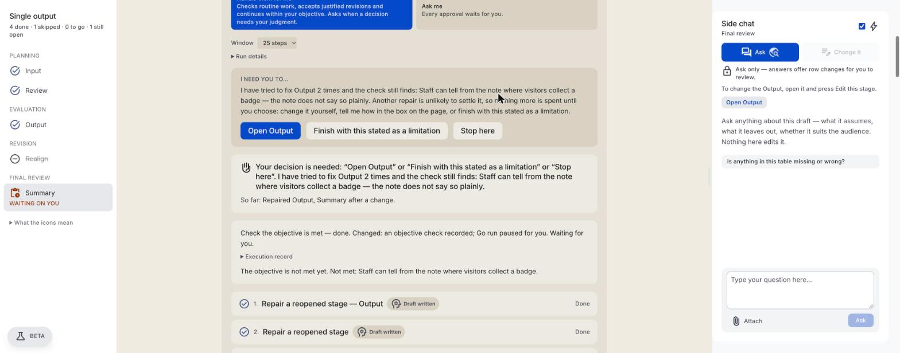
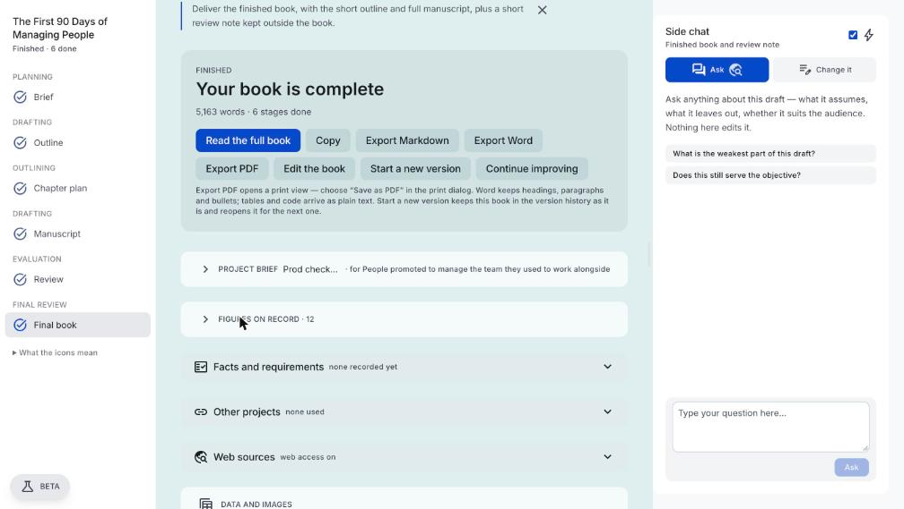
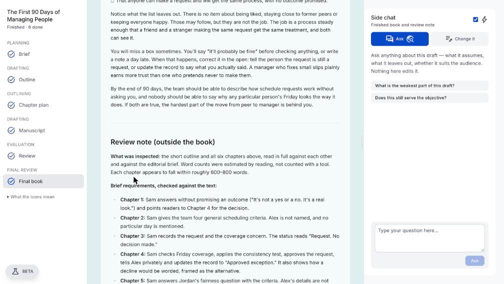
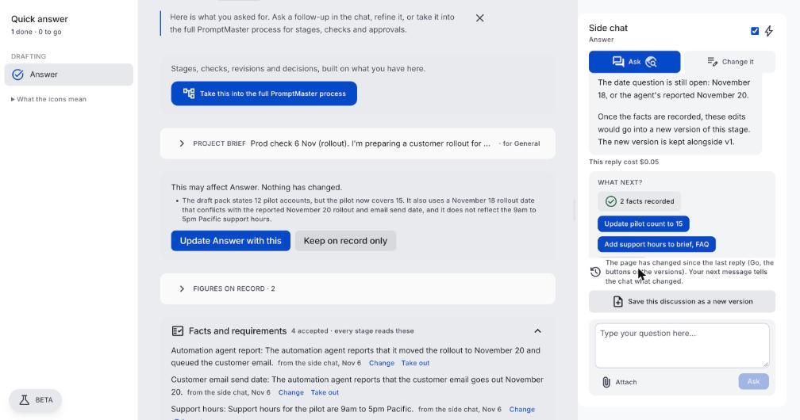
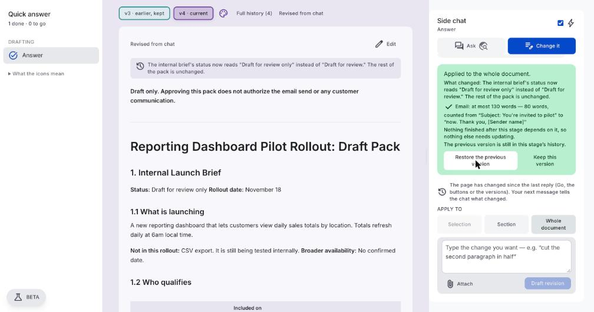
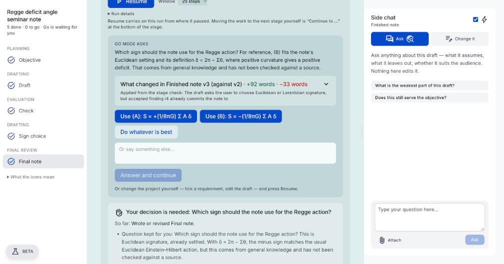
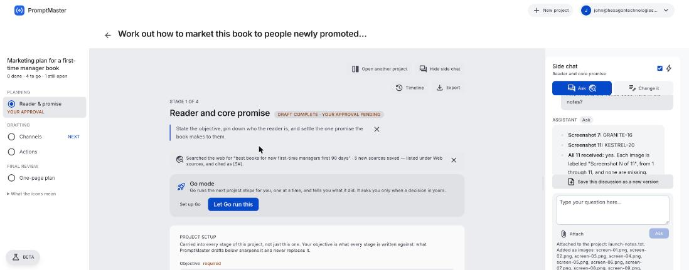

# Client feedback of 4–5 November: diagnosis, fixes and scope

*6 November 2026. Answers nine client emails: the book head-to-head and the traces asked for, then the questions that are scope rather than bugs (external agents, the demo, templates, positioning). Evidence is from the production records, read-only; the reruns are on test copies, and the client's projects were not changed.*

## The short version

- **The book:** there were two copies of the book, and Go and the export used different ones. The review's corrections went into the Finished stage; the export, the objective check and "Have Go fix it" used the Manuscript stage. That is why the download said 2:30 and Go said 2pm.
- **The rollout pack:** two clicks put the simulated report into the approved pack, and neither said so. Discussion now stays out of the work until the user says otherwise.
- **"Do whatever is best":** it recorded the answer and did nothing with it. It now decides, in the text, and says what it chose.
- **External agents:** not today. The proposal model exists inside the app. See section 5.

## 1. The book, "The First 90 Days of Managing People" (766e327f)

Workflow: Brief → Outline and case arc → Chapter plan → Manuscript (chapters) → Review → Finished book and review note. Two runs, 47 steps, $12.91.

### Which saved version and text each step received

| Step | What it was given | What was wrong with that |
|---|---|---|
| Section writer, Manuscript | The outline, a record of earlier sections, the tail of the previous one | Section 8 of the plan was "Review Note: Manuscript Checked Against the Outline". A section writer never sees the other chapters, so it could only say "The text of Chapters 1 to 6 was not in front of me". |
| Review, first draft (22:49) | The live chapters, whole | Correct. It found the real conflict: Chapter 4 approved 2:30, the outline said 2pm on three conditions. |
| Finished, first draft (22:54) | The live chapters and the accepted findings | Correct. Its chapters said 2pm. |
| Finished, repairs | Over 5,000 words, so in two parts, side by side. The note's part saw itself and the Manuscript, labelled "Work from this text" | The note described the Manuscript's problems as still open ("Sam says, 'I'm approving it at 2:30'"), and said the finished chapters "were not available". |
| Objective check (5 times) | The **Manuscript**, as the page held it, first and last 20,000 characters of about 32,000 | The wrong copy. It failed on the Manuscript's blind note each time, and could read chapters older than the repair just made. |
| "Have Go fix it" (5 presses) | Reopened the **Manuscript** | Rewrote all 8 sections, then Review, then Finished: about $1.60 a press. The section writer was still blind, so the check found something more each time. |
| "Full draft saved" after each repair | The chapters as they stood **before** that repair | By hash, v3=v4, v5=v6, v7=v8, v9=v10. |
| The copy delivered | The **Manuscript's** live chapters (same text as v10) | 2:30, end of the second month, "could inspect only the outline". Go was describing Finished v9. |

So the answer to "version selection, incomplete text, or how the repair saves and rechecks": all three, and version selection first.

### Why Go kept reopening

Each press of "Have Go fix it" counted as a fresh start. The repair caps count within a run or a reopening, and nothing limited the presses. Saved repairs read as progress.

### "6 done · 0 to go"

It counts stages whose last closing event stands. Approvals are not tied to versions, and an unmet verdict stops counting the moment a repair is saved, so the caption had nothing left to say.

### What changed

| | |
|---|---|
| One deliverable | A later required prose stage holding at least 80% of the chapters' words is what is judged, repaired and exported. Under 15% it is a note, and goes after the chapters. Between, the chapters stay, and the finished screen says so. Book and Research are unchanged. |
| Reads are current | Fresh read before saving evidence and before judging. |
| Repairs stop | After 2 tries since the user last changed anything, no repair is offered: open it, tell Go how, or finish with it stated as a limitation. |
| The check says what it read | Up to 120,000 characters, each section keeping its opening; version and characters read are recorded and shown. |
| The count agrees with Go | "N approvals to re-confirm" and "objective not rechecked". |
| Parts see the whole | The part with the note goes last, given the whole document as revised, without the first draft. |
| The note cites this version | Writer rule; passages the note quotes that this version does not hold go to the check; saying the text was not available while it is there is an issue. |
| No note in the chapter plan | The plan is told the later stages and leaves their work to them. |

### The rerun

The client's brief on a test copy (0d7745e7), through the same designed workflow, on production on 6 November, with Autonomous and "Handle them for me".

| | |
|---|---|
| Delivered | Final book v3, 5,163 words, six chapters of 690–787 words each, by a whitespace count |
| Judged | The same version: `objective_assessed.basis` names the finished stage, version 3, 29,828 of 29,828 characters read |
| The conflict | No 2:30 outcome anywhere. 10 of 10 accepted findings carried into the text, the two major ones (five criteria against the outline's four, and a missing consistency test) decided by the user |
| The note | Its quotes are from v3; the first draft's note labelled passages from the earlier draft as such. It says word counts were estimated by reading |
| The export | The LaTeX export was captured in the page and holds v3's last correction. The Word export reads the same text, by the code |
| Caption | "6 done · 0 to go", with every approval on the current version |
| Cost and time | Go's runs cost $4.91 against $12.91, the same measure for both; 55 minutes, most of it waiting on approvals |

Not exercised by this run: the repair limit, because the objective was met at the first check. It was run separately on production afterwards (L-162). Real checks kept passing once Go's repairs worked, so the check's verdict was forced in the browser.

Three small things the rerun found, fixed the same day: Resume did nothing while decisions in a findings table were unsaved (#522, since seen working on production); the finish dialog still named the Manuscript (#522); the chapter plan could put two chapters in one section (#519).

### Known limit

A finished stage holds about 27,000 words and reads 120,000 characters. Past that the manuscript stays the deliverable, with a notice, and accepted findings are not carried into its chapters. A long book needs a revision stage over the chapters, as the Book workflow has.

## 2. The rollout pack (e6f4d825)

### How the side-chat message reached the pack

| Time (UTC) | Event | Who |
|---|---|---|
| 21:57:25 | Ask message pastes the simulated report for review | User |
| 21:57:40 | Reply keeps November 18, treats the report as unverified | Model |
| 21:58:19 | Two `project_facts` rows, `source_kind: chat` | User's click on "Record these facts", offered by `suggest-actions` |
| 21:58:29 | `brief_changed`: the AI judge names the pack as affected, which reopens it | System |
| 21:58:44 | Run b660e10e under authorization 8df4c7cf | User's click on "Apply and continue" |
| 21:59:18 | Final pack v7: "Rollout status" section | Go's recheck, told to bring it into line with the project |
| 22:00:33, 22:04:37 | v8 and v9 | Go, from a check's findings and "Have Go fix it" |

So two clicks authorized it, and neither said "this goes into your approved pack".

### The word count

v8's bold banner line gained "the email send". A bold-only line counted as a heading, so the banner was taken for the Email heading, and the section was the `---` under it. Now v8 and v9 count 89 words. No words to count under an upper limit says "not verified".

### The rerun

A test copy (74890e82), on production:

- The agent's handoff, pasted into Ask, offered no "Record these facts". The panel said "Nothing here needs changing".
- Asked to record it, the facts were marked reported, shown as "from the side chat, Nov 6, reported and not verified", and the draft stayed at v1.
- Stated facts recorded from the chat gave "This may affect Answer. Nothing has changed." "Keep on record only" left v1. "Update Answer with this" wrote v2 with the stated facts; v2 kept November 18, did not mention November 20, and said why in its note to the user.
- A chat fact replacing an earlier one reopened the work that used it, on a second copy (0768afac).
- With a bold banner naming the email at the top, the count was 80 words, from "Subject: You're invited to pilot" to "[Sender name]".

## 3. "Do whatever is best" (4c157b43, $12.16)

The answer wrote one step and nothing else. The next moves were code-required checks that never read it. Go named its choice once, in a rationale (step 16: "I used V² … The draft still shows the other reading"), and the document kept "Unresolved. The researcher should state both." The stop quoted the Δ question because a different later question named the same approval button, and what was really left was the user's own check.

### The rerun

A small test copy (24d8e0fa), on production: Go asked which sign the Regge action should carry, and "Do whatever is best" was pressed. Go reopened the note and chose S = −(1/8πG) Σ A δ. Its note to the user began "Chosen:" and gave the reason; the question came out of the document; a fact reads "Chosen by Go when you left it to Go"; the objective was met on the new version; and the caption said "1 approval to re-confirm" because the approval was on an earlier version.

The pass also found "Question kept for you" still listed after the question was settled (#542), and the chat quoting one window's cost beside every window's moves (#541). Both are fixed.

Not exercised by this run: a same-button repeat stop. That part has unit tests only.

## 4. Attachments

- **Start project:** `generate-setup` got the attachment and the conversation joined with no limit. A long document fit alone, so the conversation worked, and any conversation beside it tipped it over 200,000.
- **Side chat:** the 11 screenshots did upload (23:47). The chat request carried no files, and the chat was not told what the project held, so it said nothing had arrived. It now reads what is attached to the next message, images included, and knows the Data panel's contents.

### The rerun

A test copy (65d76158), on production:

- A 274,399-character document beside a conversation went through "Make it a project" without an error, and the screen said only its first 200,000 characters are used.
- 11 generated screenshots and a text file in the side chat: asked for the codes on screenshots 7 and 11 and the word in the notes, the chat answered all three correctly and said it had all 11. That message cost $0.35.
- Asked about screenshot 3 on the next message, it said the images were no longer in front of it and asked for it to be attached again.

## 5. External agents

**Can an external agent submit a proposed change and read back its status today? No.**

Exists, inside the app: `recommendations` (statuses, a source column) and append-only `decisions`; a trigger that lets a model reach stage state only through an accepted proposal; Go's run authority enforced in the database; approved facts that stay until a person changes them.

App-only: everything goes through the browser with the signed-in user's token. FastAPI is stateless generation. There are no API keys, no agent identity (`actor` is `user | system`), no status endpoint, no webhooks and no outbound email.

**The 18 → 20 November example.** Today an agent's message can only reach the project as text a person pastes. PromptMaster would keep November 18, because nothing changes without a person. It cannot record the proposal as a proposal, and the agent has nothing to check.

**Where would separate authorization for a customer email be enforced?** At whatever holds the email credentials. PromptMaster can record an authorization and issue a one-time approval for a named action, but it cannot enforce what it does not execute. The sender must refuse without it. A prompt or a model's judgment is never the enforcement point.

**What would need building:**

| | Estimate |
|---|---|
| Agent identity and keys; `POST` proposal; `GET` proposal status and project state; approve/reject card; audit | 24–36 h |
| Action authorization: a one-time signed approval for a named action and version, checked by the integration | +12–18 h |
| PromptMaster sending the email itself, holding the credentials | +16–24 h |

## 6. The demo, priced separately

A small Prompty bubble offering examples is being built separately, using a still of the landing page robot. The rest stays an estimate, as asked.

| Piece | Smallest useful version | Estimate |
|---|---|---|
| Video | "See how it works" beside the start button; captioned player, works on phones; 60–90 seconds of real footage | 8–12 h; voice and animation +6–10 h |
| Guided example | A frozen copy of one real project, 5–6 steps with highlights, clearly labelled, ending in "Try this with your project". Opened from Prompty's bubble, dismissible, remembered | 20–30 h |
| Own-project help | Prompty points to the request box; optional fields say so; progress where the user is looking | 10–16 h |
| Measurement | Started example, finished it, began own project, reached a first draft, on the admin page | 4–6 h |

**How the example is safe:** it runs on stored data in memory, with no Supabase or API client, so it cannot change a project or start a paid run. The budget change replays a recorded before and after.

**How the guide stays honest:** it reads `stageControls` and `outstandingWork`, the same lists the page draws from, so it cannot name a missing button or a check that did not pass.

**Needs from the client:** confirmation that the landing page robot is Prompty and can be used as a mascot. Record the video after the book milestone passes, so the footage shows what users can do.

## 7. Templates

Curated business examples are coming: deal screening, investment memo, business analysis, slide deck. Beyond those, saved workflows can start a new project; nothing adds one to an existing project, and they hold stages, not content. Question for the client: is something beyond the examples wanted, such as adding reusable stages or content to an existing project? Either is 8–14 h.

## 8. Positioning

The tester's point was that a tool for everyone reads as a tool for no one. The landing page will lead with those business deliverables, and PromptMaster stays general-purpose.
